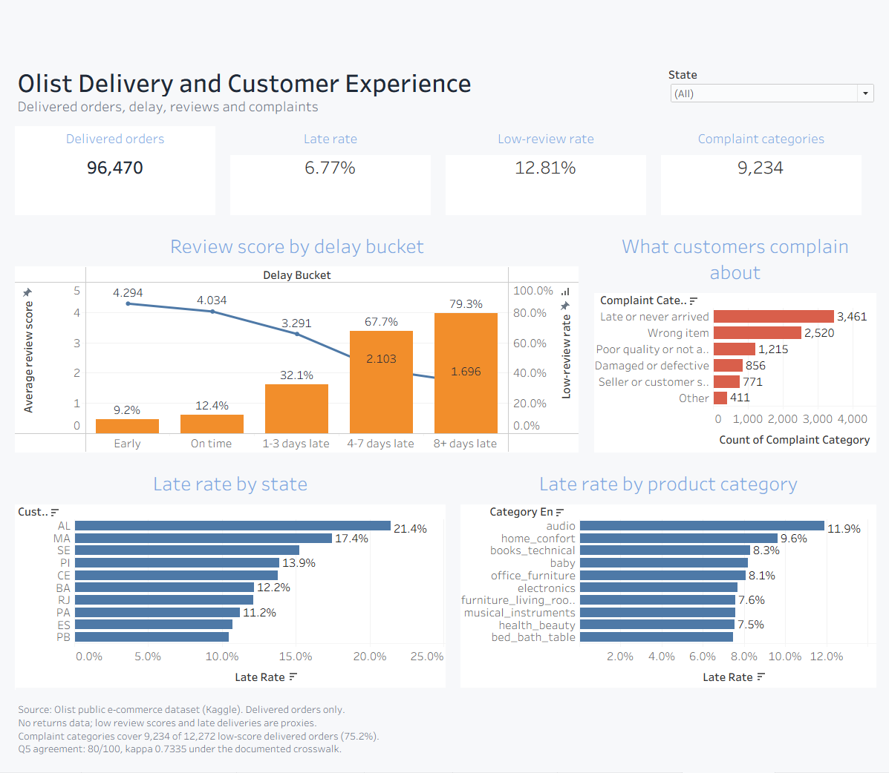

# Olist Delivery and Customer Experience Analysis

A DuckDB analysis of the public Olist Brazilian e-commerce dataset. The project measures how delivery performance relates to review scores, late rates by category/state, seller concentration, repeat purchase, and the complaints in low-score review text.

The source of truth is [`PRD.md`](PRD.md). It lives in the repo root; there is no `docs/PRD.md` in this repository.

## Contents

- [Setup](#setup)
- [Download the data](#download-the-data)
- [Run the pipeline](#run-the-pipeline)
- [Q5 review classification](#q5-review-classification)
- [Q5 agreement](#q5-agreement)
- [Dashboard](#dashboard)
- [Limitations](#limitations)
- [Findings](#findings)
- [What I got wrong](#what-i-got-wrong)

## Repository layout

```text
scripts/                 Python runners
sql/                     DuckDB SQL for quality checks, analysis tables and questions
outputs/                 CSV extracts written by the runners
tableau/                 Published Tableau workbook and dashboard screenshot
data/                    Olist CSVs (gitignored)
labels_human.csv         Hand labels for the 100-review Q5 sample
labels_model.csv         Model labels for the same 100 reviews
FINDINGS.md              One-page findings document
olist.duckdb             Local DuckDB database (gitignored)
PRD.md                   Product requirements and analysis definitions
```

## Setup

Requirements:

- Python 3.11+
- [`uv`](https://docs.astral.sh/uv/)
- Ollama, only for the Q5 LLM classification

Install the Python environment from the repo root:

```bash
uv sync
```

`uv sync` creates `.venv/` and installs DuckDB from `pyproject.toml`.

For Q5, install [Ollama](https://ollama.com/) and pull the model used in the results:

```bash
ollama pull llama3.1
ollama serve
```

The classifier defaults to `http://localhost:11434` and `llama3.1`. No hosted API key is required.

## Download the data

The source is the Kaggle dataset **Brazilian E-Commerce Public Dataset by Olist**:

<https://www.kaggle.com/datasets/olistbr/brazilian-ecommerce>

Download the dataset and extract the CSVs into `data/` in the repo root. The download is gitignored, so it is not included in the repository.

With the Kaggle CLI (install it with `uv tool install kaggle` if needed):

```bash
kaggle datasets download -d olistbr/brazilian-ecommerce -p data --unzip
```

This requires a Kaggle API token at `~/.kaggle/kaggle.json` or `%USERPROFILE%\.kaggle\kaggle.json`.

`scripts/load_to_duckdb.py` expects these nine files in `data/`:

```text
olist_customers_dataset.csv
olist_geolocation_dataset.csv
olist_order_items_dataset.csv
olist_order_payments_dataset.csv
olist_order_reviews_dataset.csv
olist_orders_dataset.csv
olist_products_dataset.csv
olist_sellers_dataset.csv
product_category_name_translation.csv
```

## Run the pipeline

Run all commands from the repo root.

### 1. Load DuckDB

```bash
uv run scripts/load_to_duckdb.py
```

Creates `olist.duckdb` and one table per CSV. Optional arguments:

```bash
uv run scripts/load_to_duckdb.py --data-dir path/to/csvs --db path/to/olist.duckdb
```

### 2. Run quality checks

```bash
uv run scripts/run_quality_checks.py
```

Runs the checks in `sql/00_quality_checks.sql`. The script exits non-zero if any row has a `FAIL` status.

### 3. Build the delivered-orders table

```bash
uv run scripts/build_analysis_table.py
```

Builds `analysis_orders` from `sql/01_analysis_orders.sql` and asserts one row per `order_id` after every stage. The table covers delivered orders with a non-null delivered date.

### 4. Run Q1-Q4

```bash
uv run scripts/run_queries.py
```

This runs the default `sql/q[1-4]_*.sql` files and writes the CSVs in `outputs/`:

- `q1_review_score_by_delay.csv`
- `q2_late_rate_by_category_state.csv`
- `q3_seller_concentration.csv`
- `q3_seller_late_rate.csv`
- `q4_repeat_purchase_by_first_order_lateness.csv`

To run one query file:

```bash
uv run scripts/run_queries.py --sql sql/q1_review_score_by_delay.sql
```

Each SQL block starts with `-- OUTPUT: <filename>.csv`.

## Q5 review classification

Q5 uses the 100-review validation sample first, then the full population. The model prompt and cache are versioned; the current prompt version is `q5-v1`.

### Sample and validation

1. Export the fixed-seed sample (only needed when rebuilding the sample):

   ```bash
   uv run scripts/export_review_sample.py
   ```

   Writes `labels_human.csv` with empty `label` values. The repository already includes a hand-labeled `labels_human.csv`; the script refuses to overwrite it unless `--force` is passed.

2. If you rebuilt the sample, hand-label the 100 rows in `labels_human.csv`. Do this before running the model.

3. Run the model on the same sample:

   ```bash
   uv run scripts/classify_reviews.py
   ```

   Reads `labels_human.csv` and writes `labels_model.csv` with `review_id`, `comment`, `label` and `confidence`. The model is local Ollama `llama3.1`, JSON mode, temperature 0, seed 42.

   Responses are cached in `.cache/llm/ollama/llama3.1/q5-v1/`. A rerun reuses every cached response and makes no model calls. Use `--refresh` only when deliberately changing the run; it ignores the cache.

4. Compare the labels:

   ```bash
   uv run scripts/compare_labels.py
   ```

   Writes agreement, confusion-matrix and disagreement files to `outputs/`, including `q5_agreement_summary.csv` and `q5_disagreements_mapped.csv`.

### Full population and Tableau export

1. Export the full low-score review population:

   ```bash
   uv run scripts/export_q5_population.py
   ```

   Writes `data/q5_full_population.csv`. With the current dataset, the export produces 10,758 distinct reviews. One review whose comment contained only a newline is excluded as having no text.

2. Classify the full population, reusing the 100 cached sample responses:

   ```bash
   uv run scripts/classify_reviews.py --input data/q5_full_population.csv --output outputs/q5_model_labels_full.csv
   ```

   The first full run is long-running: expect roughly 2.5-3 hours on a local machine at the measured throughput. It is resumable: cached responses are kept, so rerunning after an interruption only processes reviews that are not yet cached.

3. Build the Tableau CSV:

   ```bash
   uv run scripts/run_queries.py --sql sql/q5_tableau_orders.sql
   ```

   Writes `outputs/tableau_orders_with_complaints.csv`. It has one row per delivered order with the fields from `analysis_orders` plus `complaint_category`. The category comes from the same latest review used for `analysis_orders.review_score`; orders without a labeled low-score review comment have a blank category.

## Q5 agreement

These numbers are from `outputs/q5_agreement_summary.csv` for the 100-review validation sample.

| comparison | matches | accuracy | Cohen's kappa | disagreements |
|---|---:|---:|---:|---:|
| Raw exact, case-sensitive | 0/100 | 0.0000 | 0.0000 | 100 |
| Raw, case-insensitive (trailing period ignored) | 8/100 | 0.0800 | 0.0649 | 92 |
| Documented crosswalk | 80/100 | 0.8000 | 0.7335 | 20 |
| Sensitivity: Out of Stock / Cancelled -> Other | 72/100 | 0.7200 | 0.6305 | 28 |

The raw comparison is not a valid measure of model accuracy: `labels_human.csv` uses an 8-label scheme while the model uses the six PRD labels. The only textual overlap is `Wrong Item` / `Wrong item`.

The interpretable comparison is the documented crosswalk in `outputs/q5_label_crosswalk.csv`: 80/100 agreement, accuracy 0.8000, Cohen's kappa 0.7335, with 20 disagreements. This number is conditional on the crosswalk, which is an analytical assumption and does not modify either label file. If `Out of Stock / Cancelled` is mapped to `Other` instead, the sensitivity result is 72/100, accuracy 0.7200, kappa 0.6305.

The agreement is measured only on the 100-review sample. It does not by itself validate the full-population labels. Model confidence is model-reported and is not calibrated.

## Dashboard

The published one-page dashboard is here: [Olist Delivery and Customer Experience](https://public.tableau.com/app/profile/devansh.singh5277/viz/olist_delivery_dashboard_17948196428290/Dashboard1?publish=yes).

[](https://public.tableau.com/app/profile/devansh.singh5277/viz/olist_delivery_dashboard_17948196428290/Dashboard1?publish=yes)

It has four KPI cards, review score by delay bucket, complaint mix, late rate by state, and late rate by product category. The State filter is interactive. The current published version has a State filter only; the product-category filter from the PRD is a known gap.

The dashboard reads `outputs/tableau_orders_with_complaints.csv` (one row per delivered order). The category chart uses the order-level `category_en`, so its rates can differ slightly from Q2, which uses one row per order-category pair. The screenshot is a Windows capture because the installed Tableau Public version did not expose **Export Image**.

## Limitations

From `PRD.md` section 4:

1. **No returns data.** The dataset does not mark returns. Low review scores, cancellations and late deliveries are proxies, not return events.
2. **Repeat purchase uses `customer_unique_id`.** Using `customer_id` would show almost no repeat customers and would be wrong because `customer_id` is per order, not per person.
3. **Delivery dates exist only for delivered orders.** Filter to delivered orders before computing delay or delivery time.
4. **Many reviews have no text.** The LLM classification covers only reviews with non-empty comment text.
5. **Review text is Portuguese.** The model must handle Portuguese or the text must be translated first.
6. **Old data from one country.** The data covers one country and an older period. Findings are illustrative and do not predict an Indian marketplace.
7. **Review scores are subjective.** Scores can be affected by factors unrelated to delivery.

## Findings

The full one-page write-up is in [`FINDINGS.md`](FINDINGS.md).

1. **Late delivery tracks much lower satisfaction.** The 8+ days late bucket has a 79.29% low-review share and a 1.70 average score, versus 9.22% and 4.29 for early orders (`outputs/q1_review_score_by_delay.csv`).
2. **Two complaint types dominate low-score text.** Late/never arrived (3,461) and wrong item (2,520) account for 5,981 of 9,234 categorized complaints (64.8%) (`outputs/tableau_orders_with_complaints.csv`, Q5 labels).
3. **Late orders concentrate in a small seller group.** The worst 43 of 425 sellers with at least 50 delivered seller-order exposures account for 749 late orders - 15.07% of late orders from qualifying sellers and 11.46% of all late orders (`outputs/q3_seller_concentration.csv`).

The repeat-purchase check was weaker: 2.52% of customers whose first order was late placed a second order, versus 3.04% for on-time first orders (`outputs/q4_repeat_purchase_by_first_order_lateness.csv`). It is not one of the three headline findings.

## What I got wrong

- The raw Q5 comparison looked like 0/100, but that was a label-scheme mismatch, not a model failure. The interpretable result is 80/100 under the documented crosswalk, and the crosswalk is an assumption.
- The dashboard category chart uses order-level categories, while Q2 uses one row per order-category pair. Small differences are expected.
- The published dashboard has only a State filter; the product-category filter is missing.
- The repeat-purchase result is weak, so I did not make it a headline finding.

